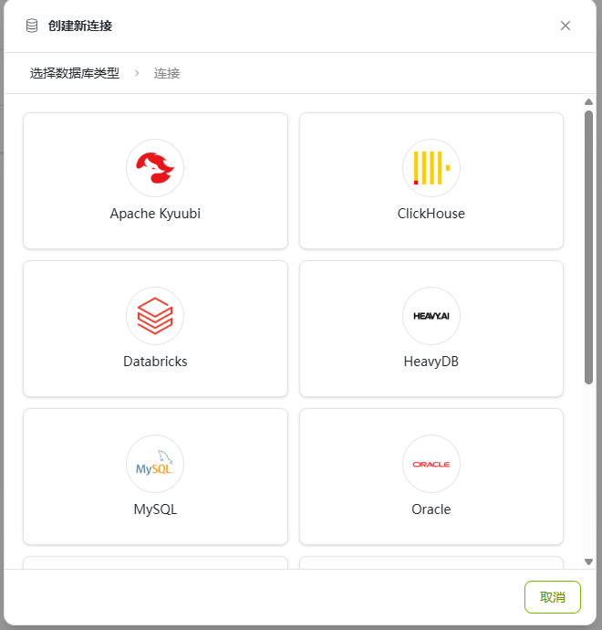

<!--
SPDX-FileCopyrightText: Copyright (c) 2026, NVIDIA CORPORATION & AFFILIATES.
SPDX-FileCopyrightText: 2026 Auto Ontology Plus contributors
SPDX-License-Identifier: Apache-2.0
本社区版本重新编写了中文项目介绍。上游英文说明保存在 README.en.md。
-->

# Auto Ontology Plus

Auto Ontology Plus 是基于 NVIDIA Auto Ontology 独立维护的社区增强版。数据工程师可以在网页上接入 Oracle，业务负责人可以用熟悉的语言查看术语、指定两张表该用哪些字段关联，让问答使用这些连接条件。管理员可以从问答记录追溯一次提问用到了什么 SQL。[开发路线图](./ROADMAP.md) · [v0.1 里程碑](https://github.com/yzmw123/auto-ontology-plus/milestone/1) · [English upstream guide](./README.en.md)

## 与 NVIDIA 上游的区别

本项目从 `d7e553e4` 分出。下表于 **2026-11-20** 对照 NVIDIA 当日的 `main`（`43fa2d3a`，提交于 2026-11-19）核对。两边独立演进。上游在分支起点之后加入了 Concept 实体及其键、聊天查询结果 CSV 导出，并更新了 Agent Skills。这些提交尚未合入本版。[分支起点](https://github.com/NVIDIA/auto-ontology/commit/d7e553e4c18112479c78b8f846e9929c4b5ed0a3) · [本次比对的上游版本](https://github.com/NVIDIA/auto-ontology/tree/43fa2d3ac3cb00f79cce23b76d57a002b0cb0168)

| 使用场景 | NVIDIA 上游 | Auto Ontology Plus |
| --- | --- | --- |
| 数据库连接 | 新建连接向导提供 8 种数据库。部署时设置 `CONNECTION_STRINGS` 会隐藏网页连接入口，采集与问答选取连接的顺序也不同。 | 向导增加 **Oracle**，9 种数据库均有品牌标识。可按服务名测试 Oracle、选择要采集的模式，保存后跟踪扫描，也可对单个数据源重新扫描并构建本体。网页连接和部署连接可共存，同名时优先使用部署配置。 |
| 多语种界面 | 网页以英语展示，设置页没有界面语言选项。 | 在 **设置 → 语言** 切换简体中文、英语、日语、韩语或西班牙语，浏览器记住选择。导航、面包屑、筛选项、术语详情、关系说明及分析记录表头随之切换。术语名称、原始提问和 SQL 保留录入内容。 |
| 探索图中的字段引用 | 能探索表、术语及其关联，也能识别外键和语义外键。上游的 Concept 实体支持以概念键作为引用目标。 | 管理员可点节点的 **编辑链接**，并排选两张表、逐对匹配字段，再给连线命名。支持复合键、同表引用，以及同一对表的多种业务关系。启用的字段引用显示为蓝线，回到同一节点时显示为蓝环。点线可查看字段对。勾选 **用于问答** 后，问答可以检索这条关系并校验 SQL 的连接条件。 |
| 数据分析与问答记录 | 提供最近 30 天的分页记录和 CSV 下载，表格展示时间、用户、渠道、问题、思考说明和 SQL。 | 默认仍看最近 30 天，可按日期范围、用户名或邮箱、渠道组合筛选。列表单行显示，时间精确到秒。点任意一行即可滚动查看完整问题、思考说明、SQL 和提问、回答时间。CSV 沿用当前筛选，有删除权限的用户可单条删除。 |

例如，收费记录里同时有“入口站编号”和“出口站编号”，两者都能匹配收费站表的“站编号”。在 Plus 中可分别建成“入口站”和“出口站”两条连线。用户问“各出口站收了多少钱”时，问答可以沿“出口站”匹配字段。管理员随后可以在 **数据分析** 中找到这次提问，核对实际使用的 SQL。

查看新建数据库连接界面

## 本期更新（待发布）

- **新增**　提供五种界面语言、Oracle 连接、可编辑的字段引用与术语分类，以及问答记录的组合筛选和详情弹窗。
- **优化**　发现页打开即可浏览目录。术语详情页的问号解释实体、区域和相关术语。「添加计算项」定义一个值怎么算，「新建分析查询」保存可重复使用的查询。分析记录按筛选导出，CSV 表头沿用界面语言。
- **解决 Bug**　修复了已配置环境数据源时数据库连接入口被隐藏的问题，并补齐了中文界面中筛选项、面包屑、关系详情和分析表头的英文残留。

已有部署升级时，请先将本体元数据库的 Alembic 迁移到包含 `5df49f29a231` 的版本，再使用字段引用与术语分类。[发布记录](./CHANGELOG.md) · [数据源连接说明](./docs/connections.md)

## 从一个业务问题开始

“本月收入是多少？”销售部门按下单时间统计订单金额，财务部门按入账时间统计扣除退货后的金额。两种答案都可能正确。要让报表和智能体用对口径，系统需要知道谁在问、适用哪种定义、何时生效，以及能用哪些数据核对。

v0.1 将用一套公开的合成订单与退货数据演示这个过程。数据工程师接入数据并检查采集结果，业务负责人审核两条定义和依据，使用者再从网页或 MCP 客户端用中英文查询。验收时会核对两个入口引用的定义、范围和计算结果。[首版场景任务](https://github.com/yzmw123/auto-ontology-plus/issues/1) · [端到端验收任务](https://github.com/yzmw123/auto-ontology-plus/issues/6)

## 当前可用的上游能力

本仓库从 NVIDIA 的 `d7e553e` 起步。当前代码可用于采集数据库元数据，生成业务术语、字段映射、关系和 SQL 指标；业务人员可以审查并认证定义，应用可以通过 REST API、CLI 和只读 MCP 使用本体。上游还提供角色权限、单点登录、Ossie 模型交换，以及安装、管理、查询三套 Agent Skills。[工作原理](./README.en.md#how-it-works) · [认证与权限](./docs/authentication.md) · [MCP 接入](./docs/mcp.md) · [Agent Skills](./skills)

| 使用目的 | 规划中的 Plus 增强 |
| --- | --- |
| 多个地区共用指标 | 为同一概念维护多语名称、别名与审核状态；地区口径不同时展示适用范围。 |
| 接入新的业务系统 | 扩展数据库类型，公布各引擎对元数据、采样、查询和刷新的支持情况。 |
| 让业务负责人维护口径 | 记录规则的依据、负责人、粒度和生效时间，逐步支持变更影响分析、发布和回退。 |
| 管理访问并排查问题 | 在网页、API 与 MCP 验证访问范围，按请求编号关联接入、编译日志和业务操作记录。 |

后续规划的范围和依赖见[开发路线图](./ROADMAP.md)，v0.1 里程碑列出了各项任务的验收条件。[查看开发任务](https://github.com/yzmw123/auto-ontology-plus/milestone/1)

## 运行现有示例

1. 克隆本仓库，准备 Docker Compose v2、`uv` 和模型服务密钥。将根目录的 `.env.example` 复制为 `.env`，设置 `AUTH_SECRET`、应用地址、模型密钥和各服务密码。[配置示例](./.env.example)
2. 在仓库根目录运行 `docker compose up -d --wait postgres`。按英文快速开始的第 2 步，在专用演示库载入 Wide World Importers 样例，使用与 `.env` 一致的数据库密码。[样例载入命令](./README.en.md#quickstart)
3. 运行 `docker compose up -d --build`，打开 [本地应用](http://localhost:3000)，使用配置的管理员账号登录。在 **Settings → Semantic Compilation** 开启语义编译，状态就绪后进入 **Chat** 试问样例问题。[样例问题与参考结果](./README.en.md#quickstart)

集群部署可使用 Helm。模型端点、密钥与各模型角色在配置文件中分别指定。[部署指南](./DEPLOYMENT.md) · [模型配置](./README.en.md#models) · [数据源连接](./docs/connections.md)

## 参与项目

欢迎提交具体业务场景、语言样例、数据库兼容性结果和复现记录。请写清使用环境、预期口径与实际结果，并使用可公开的样例数据。开发任务在本仓库跟踪；适合 NVIDIA 上游的通用改动，按其贡献流程沟通。[本项目 Issues](https://github.com/yzmw123/auto-ontology-plus/issues) · [上游贡献指南](https://github.com/NVIDIA/auto-ontology/blob/main/CONTRIBUTING.md)

本项目沿用 Apache-2.0 许可证，保留 NVIDIA 及第三方声明。[LICENSE](./LICENSE) · [第三方声明](./THIRD_PARTY_NOTICES.md) · [容器组件声明](./CONTAINER_THIRD_PARTY_NOTICES.md) · [NVIDIA 原项目](https://github.com/NVIDIA/auto-ontology)
